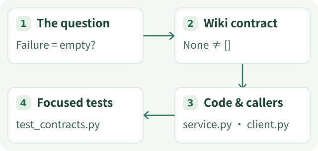

# ProjectWikiSkill

### Know what you're changing before you change it.

Back after a week away, you pick up an API someone else changed. The code is familiar; which document still describes what callers rely on?

PWS is a portable Skill that connects that question to the project's Wiki, implementation and checks — so the next change starts with evidence, and the next person can find it again.

**English** · [简体中文](README.zh-CN.md)

**[Try it without a plugin ↓](README.md#quick-start)** · [Use with your agent](README.md#install) · [PWS's own Wiki](docs/wiki/engineering-entry.md)

<a name="one-question-a-useful-starting-point"></a>
## From a guess to a change you can explain

**Before:** “The service failed. Can I just return an empty list?”



**After checking the example:** `None` means unavailable; `[]` means a successful empty result. The service preserves that distinction, while the legacy client loses the precise error. Returning an empty list on failure would erase information the contract requires.

You now have a [contract to preserve](evals/fixture-project/docs/wiki/interfaces.md#public-api), an [implementation](evals/fixture-project/src/service.py) and [caller](evals/fixture-project/src/client.py) to inspect, and [focused tests](evals/fixture-project/tests/test_contracts.py) to run. The [diagnostic exercise](evals/fixture-project/tests/test_diagnostic_evidence.py) shows how to check the evidence, too. This is a synthetic offline example, not a production incident.

## Quick start

**Run the offline example.** No agent, plugin or API key is needed. From a checkout of this repository, confirm **Python 3.10+** with `python --version`, then paste this single line (also suitable for Windows PowerShell):

```sh
python project-wiki/scripts/wiki.py query --root evals/fixture-project "How are service client failures handled?" --limit 1
```

The result names `public-api`, links the contract and source locations above, and identifies the two test files. It locates checks; it does not execute them or prove live service behavior.

The helpers use only the Python standard library. On macOS/Linux, if your compatible interpreter is named `python3`, confirm `python3 --version` and use `python3` instead.

<a name="使用"></a>
<a name="独立-skill-与-python-工具"></a>
## Install

**A plugin is optional. Reading the Skill is enough to start.**

The reusable unit is the **whole [`project-wiki/` directory](project-wiki/SKILL.md)**, including its references, scripts and metadata. Choose the path your tools support:

<a name="any-coding-agent-that-can-read-project-files"></a>
### Read it with any coding agent

Check out this repository where your agent can read it, or copy the whole directory into a project-approved, shareable location. Then explicitly ask the agent to use it:

> Read `project-wiki/SKILL.md` first. For this task, follow the relevant linked references and the project's existing Wiki. Find the owning pages, verify the source and checks, and return durable decisions and evidence to their existing owner.

Adjust that entry path to its actual location. This is **explicit use** of project files; it does not register the Skill or promise automatic discovery.

<a name="a-host-with-a-skill-loader"></a>
### Let a Skill loader find it

Place the same whole directory in the host's **documented Skill discovery path**, then use its documented invocation. Discovery and compatibility depend on the host; no universal installer is assumed.

<a name="codex-standalone-skill"></a>
<a name="在-claude-code-安装插件"></a>
<a name="claude-code-marketplace-plugin"></a>
<details>
<summary><strong>Optional host setup: Codex, Claude Code, Marketplace and hooks</strong></summary>

- **[Codex](https://developers.openai.com/codex/skills):** project-local `.agents/skills/project-wiki/`; invoke `$project-wiki`.
- **[Claude Code](https://code.claude.com/docs/en/skills):** project-local `.claude/skills/project-wiki/`; invoke `/project-wiki`.

Follow each host's documentation for user-wide paths and discovery. These examples do not establish support for other hosts or their hooks.

**Claude Code Marketplace** is another optional entry:

```sh
claude plugin marketplace add sairaisaika/projectWikiSkill
claude plugin install project-wiki@project-wiki
```

In a new session, invoke `/project-wiki:project-wiki`. This marketplace entry exposes one Skill, without hooks. Inspect components with `/plugin`; if another marketplace supplies the same name, check `claude plugin list` before choosing a source. See [Claude's plugin guide](https://code.claude.com/docs/en/discover-plugins).

Optional `SessionStart` integration and the Claude-only `PreToolUse` gate are documented in [lifecycle delivery](project-wiki/references/collaboration-workflow.md#optional-lifecycle-delivery). They are separate from explicit use and the Python demo; packaging does not install or grant trust to hooks.

</details>

## Use it on your project

**Ask → locate → verify → return.** Start at the [task menu](project-wiki/SKILL.md#choose-the-work). Your native Wiki stays the authority: [reuse its navigation and checks](project-wiki/references/native-wiki-adoption.md), and leave a small edit in a known file on the project's lightweight path.

The runnable example uses PWS's route format. For an existing project, choose helpers through the adoption guide; a missing `routes.json` is not a reason to replace the project's own navigation.

<a name="cli-reference"></a>
## Guides

- **Choose a task:** the [Skill's task menu](project-wiki/SKILL.md#choose-the-work) links to the relevant method, from orientation to maintenance and handoff.
- **Use the Python tools:** the [Wiki helper contract](docs/wiki/architecture.md#wiki-helper) and [workflow commands](project-wiki/references/collaboration-workflow.md) explain inputs, outputs and limits.
- **Contribute to PWS:** the [maintainer entry](docs/wiki/engineering-entry.md) owns architecture, packaging and repository checks.

## Repository status

For verified versions and evidence, see [status](docs/wiki/status.md#current-state), the [canonical manifest](plugin.json), [changelog](CHANGELOG.md) and [evaluation reports](evals/reports/README.md).
