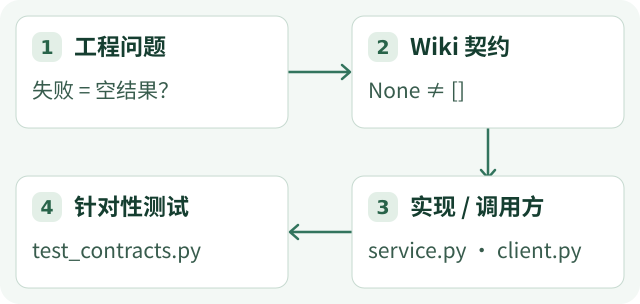

# ProjectWikiSkill

### 改代码前，先知道你在改什么。

隔了一周回来，接手别人改过的接口。代码还认得，哪份文档仍然可信？调用方究竟依赖什么？

PWS 是一个可独立使用的工程 Skill，把这些问题连到项目自己的 Wiki、实现和检查。让这次改动有据可依，也让下一个接手的人找得到依据。

[English](README.md) · **简体中文**

**[不装插件，先试一次 ↓](README.zh-CN.md#快速开始)** · [交给编程 Agent](README.zh-CN.md#安装) · [PWS 自用 Wiki](docs/wiki/engineering-entry.md)

<a name="问一句找到从哪里开始"></a>
## 从「应该没事」到说得清楚

**原先想的是：**「服务失败了，直接返回空列表行不行？」



**核对样例后：** `None` 表示不可用，`[]` 表示成功但没有结果。服务保留了这一区别，旧客户端却会丢失具体错误。若把失败也改成空列表，就抹掉了契约要求保留的信息。

现在，手上有了[不能破坏的契约](evals/fixture-project/docs/wiki/interfaces.md#public-api)、要核对的[实现](evals/fixture-project/src/service.py)与[调用方](evals/fixture-project/src/client.py)，以及该跑的[针对性测试](evals/fixture-project/tests/test_contracts.py)。[诊断演练](evals/fixture-project/tests/test_diagnostic_evidence.py)还展示了如何检查证据。这是仓内合成的离线样例，不是真实生产事故。

<a name="quick-start"></a>
## 快速开始

**试跑离线样例。** 无需 Agent、插件或 API key。在本仓库的检出目录，先用 `python --version` 确认是 **Python 3.10+**，再粘贴下面这一行（Windows PowerShell 也使用同一命令）：

```sh
python project-wiki/scripts/wiki.py query --root evals/fixture-project "How are service client failures handled?" --limit 1
```

结果会定位到 `public-api`，给出上面的契约与源码位置，并列出两份测试文件。查询负责找到检查，不会执行它们，也不证明真实服务的运行情况。

工具只使用 Python 标准库。在 macOS/Linux 上，如果兼容的解释器叫 `python3`，先确认 `python3 --version`，再改用 `python3`。

<a name="install"></a>
<a name="使用"></a>
<a name="独立-skill-与-python-工具"></a>
## 安装

**插件是可选项，先读 Skill 就能开始。**

可复用的单元是**整个 [`project-wiki/` 目录](project-wiki/SKILL.md)**，包括其中的参考文档、脚本和元数据。按工具能力选择入口：

<a name="任何能读项目文件的编程-agent"></a>
### 让能读项目文件的 Agent 显式使用

将本仓库检出到 Agent 能读取的位置，或把完整目录放到项目批准、可共同引用的位置。然后明确让 Agent 使用它：

> 先读 `project-wiki/SKILL.md`。针对当前任务，按需阅读已链接的参考文档，并沿用项目自己的 Wiki。找到负责页面，核对源码与检查，把稳定决策和证据回写到原来的负责位置。

入口路径以实际放置位置为准。这是对项目文件的**显式使用**，不会注册 Skill，也不承诺自动发现。

<a name="带有-skill-loader-的宿主"></a>
### 让 Skill loader 发现它

将同一个完整目录放进宿主**文档规定的 Skill 发现路径**，按其说明调用。发现机制和兼容范围由宿主决定，不假设存在通用安装器。

<a name="codex作为独立-skill-安装"></a>
<a name="在-claude-code-安装插件"></a>
<a name="claude-code通过插件市场安装"></a>
<details>
<summary><strong>可选宿主设置：Codex、Claude Code、Marketplace 与 hooks</strong></summary>

- **[Codex](https://developers.openai.com/codex/skills)：** 项目内放到 `.agents/skills/project-wiki/`，用 `$project-wiki` 调用。
- **[Claude Code](https://code.claude.com/docs/en/skills)：** 项目内放到 `.claude/skills/project-wiki/`，用 `/project-wiki` 调用。

用户级路径和发现方式以各宿主文档为准。这些示例不代表其他宿主或其 hooks 已获支持。

**Claude Code Marketplace** 是另一个可选入口：

```sh
claude plugin marketplace add sairaisaika/projectWikiSkill
claude plugin install project-wiki@project-wiki
```

在新会话中调用 `/project-wiki:project-wiki`。本市场入口提供一个 Skill，不含 hooks。用 `/plugin` 查看组件；若其他市场提供同名插件，先用 `claude plugin list` 确认再选择来源。详见 [Claude 插件指南](https://code.claude.com/docs/en/discover-plugins)。

可选的 `SessionStart` 集成和仅适用于 Claude 的 `PreToolUse` 编辑闸见[生命周期投递](project-wiki/references/collaboration-workflow.md#optional-lifecycle-delivery)。它们与显式使用、Python demo 分开；打包不等于安装或授予 hooks 信任。

</details>

## 用到自己的项目

**提问 → 定位 → 核对 → 回写。** 从[任务菜单](project-wiki/SKILL.md#choose-the-work)开始。项目原有 Wiki 仍是事实来源：[沿用它的导航和检查](project-wiki/references/native-wiki-adoption.md)，已知文件里的小改动继续走项目原有的轻量路径。

可运行样例使用 PWS 的路由格式。接入已有项目时，按接入指南选择工具；缺少 `routes.json` 不意味着应该替换项目自己的导航。

<a name="cli-reference"></a>
<a name="命令行工具"></a>
<a name="guides"></a>
## 阅读指南

- **选择任务：** [Skill 任务菜单](project-wiki/SKILL.md#choose-the-work)按需链接到具体方法，涵盖导读、维护与交接。
- **使用 Python 工具：** [Wiki 工具契约](docs/wiki/architecture.md#wiki-helper)和[工作流命令](project-wiki/references/collaboration-workflow.md)说明输入、输出与限制。
- **参与 PWS 开发：** [维护者入口](docs/wiki/engineering-entry.md)负责架构、打包和仓库检查。

<a name="repository-status"></a>
## 仓库状态

已验证版本与证据见[状态页](docs/wiki/status.md#current-state)、[权威 manifest](plugin.json)、[更新记录](CHANGELOG.md)和[验证报告](evals/reports/README.md)。
