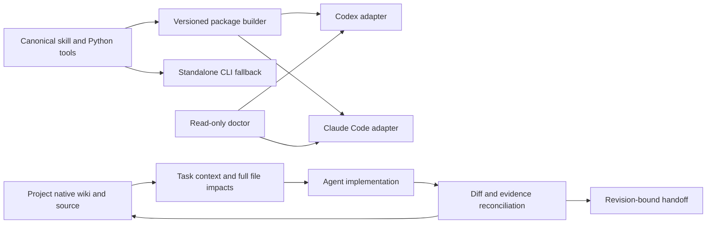

# Internal collaboration plugin, v0.2.4 payload

Status: packaging, doctor and a native JSON workflow including read-only task
scope are implemented in the adopted 0.2.3 payload. Scoped Linux Claude Skill use
and guided native recovery have separate receipts below. On 2026-10-22 a valid
but stale Codex 0.2.2 cache was detected and updated through the official CLI to
0.2.3; inventory, installed source closure and a fresh read-only CLI query were
checked. See the [bounded refresh receipt](../evals/reports/codex-host-refresh-20261022.md).
Automatic lifecycle behavior and desktop GUI fresh-session discovery remain
unverified. This is not publicly released.
The skill and its Python helper remain the canonical method and tool sources.
Generated packages are projections, never another editable wiki.

The 2026-10-22 review checkpoint adds optional 0.2.4 return preparation from a
fresh real native review. A useful human report originally failed the existing
machine return contract. The candidate generated unreviewed fields, and the same
reviewer actually used them in a guided retry; old/new helpers accepted the
corrected shape while retaining a capability gap. This is separate from normal
source adoption, official installed-cache refresh and automatic lifecycle support.
See the [bounded native return receipt](../evals/reports/native-readonly-return-20261022.md).

## Intended result

A successor agent can locate a change, receive its boundaries, implement it and
return evidence to the same feature entry without reconstructing the preceding
conversation. Packaging alone does not establish this result.

Codex owns this plugin's implementation and independent project review. Engineering
workers own the feature-local wiki changes accompanying their implementation.
The coordinator reconciles shared files and verifies their return. This is not a
separate documentation worker writing every other agent's documentation.

## Architecture and ownership



The native project's metadata, rules and debt ledger remain authoritative within
their existing responsibilities. Source and runtime evidence can contradict prose.
No project data, credential or runtime log is copied into a published plugin.
MCP is optional transport over the same tools, not a prerequisite or another core.

## Delivery slices and exit evidence

| Slice | Inputs and producers | Consumer and result | Exit evidence | Current state |
|---|---|---|---|---|
| Package | canonical skill, versioned identity, explicit payload policy | Codex/Claude package with the same skill bytes | payload hashes, self-contained links, rejection of symlink/unsafe outputs, real host manifest validation | v0.1/v0.2 Linux validated; v0.2 packaged Skill and scoped workflow reads observed |
| Doctor | selected package and optional canonical source/transcript | component/version/source-closure and scoped CLI observations | tampered/missing/extra files detected; installation, trust and runtime remain unknown unless actually inspected | payload/skill/support-source inspection and real Claude transcript observation implemented; actual stale Codex cache detected and refreshed; official inventory remains separate |
| Start/delegate | user task, source pair, planned files, native task route | bounded context packet: actors, fields, producers/consumers, failures, checks and allowed edits | existing native indexes reused; all file satellites retained; missing/dirty/mismatched peers reported | real capture/start/delegate and worker show/read observed |
| Finish/handoff | actual diff, observed checks, selected source pair | updates or justified no-update result at the original entry; exact revision and remaining work | omission mutants and real successor recovery; no inference from delivered packet to read/used | real 16-file return reconciled; two omitted-review counterexamples rejected; viewport runtime gap retained |
| Host lifecycle | actual supported events and reviewed hook definitions | scoped entry/recovery prompts | current Codex and Linux Claude runtime receipts; unsupported host gets explicit CLI fallback | pending |
| Project pilot | independent theme and scratch-composer engineering tasks | project repair and reusable rule improvement | real worker output/source review, missed capability and wrong schema assumptions retained as negatives | in progress, no efficiency result |

## Evidence layers

Report these independently: package validation; installation/enabling; hook trust
and execution; context delivery; actual agent use and semantic correctness; product
runtime acceptance. None implies the next. Do not create an always-loaded roster of
commands or require full-wiki reading on every turn. A receipt is not a reading test.

First counterexamples: an old installed skill copy may diverge from its repository;
a task packet may never be used; a shared HTTP endpoint may have a separate reduced
editor; a named migration constraint may exist with a different definition. The
plugin must help expose these distinctions rather than give them passing stamps.

## Host references inspected

- [OpenAI packaging](https://developers.openai.com/plugins/build/plugins): portable
  root manifest and conventional skills directory; compatibility manifest supported.
  Manually installed desktop hooks require separate review/trust; not automatic.
- [Claude manifest](https://code.claude.com/docs/en/plugins-reference): custom skill
  paths supported, validator is authoritative. Host adapters must not silently rely
  on unsupported fields or claim equivalent hook availability.

## Verification still required

- Actual package build and eight adversarial packaging/doctor cases passed locally;
  see [bounded receipt](../evals/reports/internal-plugin-package-20261021.md).
- Linux Claude manifest validation and one real packaged-skill invocation passed;
  v0.2 also loaded its packaged Skill and read the native index/selected records.
  Complete automatic host lifecycle behavior remains unverified.
- Codex desktop fresh-session component discovery and current hook trust behavior.
  Official CLI installation/inventory and cached source identity passed separately.
  A fresh read-only CLI session also read the installed Skill and ran its actual
  fixture query; see [bounded host receipt](../evals/reports/codex-host-discovery-20261021.md).
  Neither result is a desktop GUI, hook or real-project adoption result.
- Full start/delegate/finish/recovery cycle, runtime source closure and task latency.
- Fresh agent comparison; the current coordinator's familiar self-review is not a
  blind trial, independent adoption or proof of speedup.

## Local candidate commands

```text
python scripts/package_plugin.py --output <new-directory-outside-this-checkout>
python scripts/plugin_doctor.py --package <built-directory> --source <canonical-checkout>
python project-wiki/scripts/workflow.py --help
```

The build does not modify host configuration or overwrite an existing output.
Interrupted builds have no complete receipt and fail inspection. Hash receipts
detect accidental drift, not package authorship or an attacker replacing both the
payload and its receipt. Versioned distribution and trusted origin remain separate.
Doctor does not execute hook scripts, scan project secrets or claim host installation.
It is also distributed in the built package. The native JSON task-card bridge now
has capture/start/show/delegate/finish commands and explicit peer selection; see
[workflow instructions](../project-wiki/references/collaboration-workflow.md).
Its isolated scenarios are mechanism tests, not a host lifecycle or independent
adoption result. The real recovery trial and host lifecycle hooks remain
required; a valid archive alone does not satisfy this plan's exit criteria.

The native Syleli trial retains 16 planned files, 14 satellite references, one
omitted candidate and explicit Web/App revisions. The worker invoked `show` and
read the host-persisted full output after its 2 KiB preview was clipped. This exposed
an ergonomics failure: complete transport does not guarantee convenient reading.
The CLI now defaults to an explicit index and offers exact feature/file expansion;
all records remain available. This is a guided same-worker recovery, not measured
speedup or blind adoption. The actual return now reconciles structurally and keeps
viewport acceptance as a gap; it does not certify the worker's semantic claims.
See the [workflow receipt](../evals/reports/native-workflow-20261021.md).

## Native return context candidate (v0.2.2)

Actual scratch adoption exposed a late native commit acknowledgement requirement.
The bounded follow-up keeps that format/parser in the project and transports its
optional workflow metadata in every plugin reading view. Old reports say undeclared;
commands remain quoted, never executed. [Mechanism receipt](../evals/reports/native-return-context-20261022.md)
separates passing transport/negative tests from fresh-agent adoption, CI and runtime
acceptance still pending. This does not implement or claim trusted host hooks.


## C22 live engineering checkpoint

The internal v0.2.2 distribution has been normally adopted in this repository;
its project-native adapter is still a separate candidate. A real Linux worker
used the Skill, source-backed feature/impact records and an explicit scope
amendment, then returned implementation. Independent visual review rejected part
of the first result and a fresh packet was used for the resumed task. Full
finish/runtime closure and efficiency measurements remain open. The
[bounded receipt](../evals/reports/live-collaboration-c22-20261022.md) preserves
wrong-path, audience-policy and native generation gaps without adding global
reading or hook requirements. This checkpoint does not change the plugin payload.

## Read-only task packets: 0.2.3 source adopted (2026-10-22)

Live Syleli source-structure adoption trial exposed a scope mismatch: `start`
required `--allow-file`, and its implementation required all captured source
paths to be editable. The intended fresh Claude task was only to read/interpret
three files' wiki and deterministic structure facts; no task/session was launched
after the rejection. The first capture also used the wrong lockfile name; the
missing-input rejection worked, and the corrected capture uses package.json and
pnpm-lock.yaml. Neither failure establishes an agent-use result.

The change adds explicit read-only start/delegation/display/reconciliation, with
empty editing paths and unchanged legacy editing behavior. A nominal read-only
return with wiki/source differences is not certified as unchanged. This is scoped
workflow metadata, not filesystem enforcement or proof of no transient/ignored
writes. Native extra impact fields remain intact. Version bump changes the actual
bundled workflow/reference payload. PR5 normally merged to main4ea89e1 after both
CI matrix runs passed. A fresh scoped Linux invocation used the candidate Skill
and native per-file structures, then returned an empty repository diff; initial
CLI/display/section-reading misses were preserved rather than called first-pass
success. The [bounded report](../evals/reports/source-structure-readonly-adoption-c22-20261022.md)
records native follow-up fixes and remaining acceptance. This docs checkpoint
does not change the 0.2.3 payload. Permanent host updates/discovery, hooks and
semantic/business acceptance still need their own evidence.

## Native source changes and parent/child adoption (C23)

The [ongoing guided case](../evals/reports/source-delta-and-child-adoption-c23-20261022.md)
separates current source facts from baseline/current investigation, and a worker's
return from coordinator integration and runtime verification. Two actual Linux
Claude child reviews and their source-level use are observed; root integration,
exact CI and actual product acceptance are still pending.
Use the existing native task log for owner, actual stage and next action, not a
parallel business ledger. This evaluation adds no payload, hook or runtime gate;
v0.2.3 host/discovery and independent takeover acceptance remain separate.
