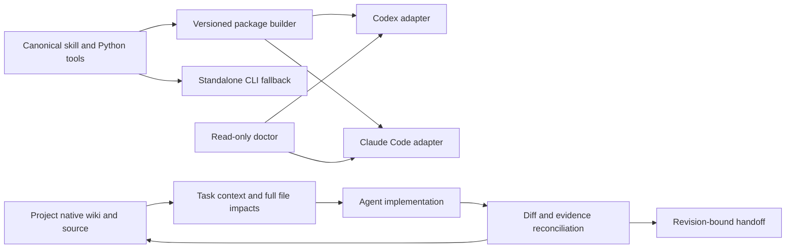

# Internal collaboration plugin, v0.1

Status: packaging and doctor implemented locally; Linux Claude manifest validation
passed. Not installed, enabled, lifecycle-tested or published.
The skill and its Python helper remain the canonical method and tool sources.
Generated packages are projections, never another editable wiki.

## Intended result

A successor agent can locate a change, receive its boundaries, implement it and
return evidence to the same feature entry without reconstructing the preceding
conversation. Packaging alone does not establish this result.

Codex owns this plugin's implementation and independent project review. Engineering
workers own the feature-local wiki changes accompanying their implementation.
The coordinator reconciles shared files and verifies their return. This is not a
separate documentation worker writing every other agent's documentation.

## Architecture and ownership



The native project's metadata, rules and debt ledger remain authoritative within
their existing responsibilities. Source and runtime evidence can contradict prose.
No project data, credential or runtime log is copied into a published plugin.
MCP is optional transport over the same tools, not a prerequisite or another core.

## Delivery slices and exit evidence

| Slice | Inputs and producers | Consumer and result | Exit evidence | Current state |
|---|---|---|---|---|
| Package | canonical skill, versioned identity, explicit payload policy | Codex/Claude package with the same skill bytes | payload hashes, self-contained links, rejection of symlink/unsafe outputs, real host manifest validation | local implementation, host validation pending |
| Doctor | selected package and optional canonical source | component/version/source-closure report | tampered/missing/extra files detected; installation, trust and runtime remain unknown unless actually inspected | local implementation, installation/host probes pending |
| Start/delegate | user task, source pair, planned files, native task route | bounded context packet: actors, fields, producers/consumers, failures, checks and allowed edits | existing native indexes reused; all file satellites retained; missing/dirty/mismatched peers reported | pending |
| Finish/handoff | actual diff, observed checks, selected source pair | updates or justified no-update result at the original entry; exact revision and remaining work | omission mutants and real successor recovery; no inference from delivered packet to read/used | pending |
| Host lifecycle | actual supported events and reviewed hook definitions | scoped entry/recovery prompts | current Codex and Linux Claude runtime receipts; unsupported host gets explicit CLI fallback | pending |
| Project pilot | independent theme and scratch-composer engineering tasks | project repair and reusable rule improvement | real worker output/source review, missed capability and wrong schema assumptions retained as negatives | in progress, no efficiency result |

## Evidence layers

Report these independently: package validation; installation/enabling; hook trust
and execution; context delivery; actual agent use and semantic correctness; product
runtime acceptance. None implies the next. Do not create an always-loaded roster of
commands or require full-wiki reading on every turn. A receipt is not a reading test.

First counterexamples: an old installed skill copy may diverge from its repository;
a task packet may never be used; a shared HTTP endpoint may have a separate reduced
editor; a named migration constraint may exist with a different definition. The
plugin must help expose these distinctions rather than give them passing stamps.

## Host references inspected

- [OpenAI packaging](https://developers.openai.com/plugins/build/plugins): portable
  root manifest and conventional skills directory; compatibility manifest supported.
  Manually installed desktop hooks require separate review/trust; not automatic.
- [Claude manifest](https://code.claude.com/docs/en/plugins-reference): custom skill
  paths supported, validator is authoritative. Host adapters must not silently rely
  on unsupported fields or claim equivalent hook availability.

## Verification still required

- Actual package build and eight adversarial packaging/doctor cases passed locally;
  see [bounded receipt](../evals/reports/internal-plugin-package-20261021.md).
- Linux Claude manifest validation passed; real invocation of the packaged skill
  is dispatched but not yet verified.
- Codex desktop installation/source discovery and current hook trust behavior.
- Full start/delegate/finish/recovery cycle, runtime source closure and task latency.
- Fresh agent comparison; the current coordinator's familiar self-review is not a
  blind trial, independent adoption or proof of speedup.

## Local candidate commands

```text
python scripts/package_plugin.py --output <new-directory-outside-this-checkout>
python scripts/plugin_doctor.py --package <built-directory> --source <canonical-checkout>
```

The build does not modify host configuration or overwrite an existing output.
Interrupted builds have no complete receipt and fail inspection. Hash receipts
detect accidental drift, not package authorship or an attacker replacing both the
payload and its receipt. Versioned distribution and trusted origin remain separate.
Doctor does not execute hook scripts, scan project secrets or claim host installation.
It is also distributed in the built package. Lifecycle and native routing adapters
are still pending; a valid archive alone does not satisfy this plan's exit criteria.
