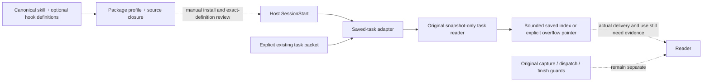
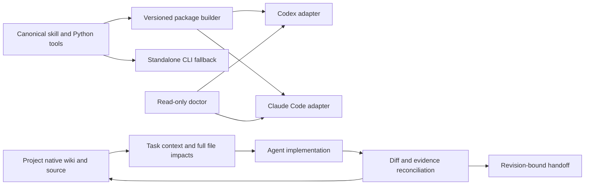

# Internal collaboration plugin / bounded host observations

## 0.2.12 candidate: observed-host compatibility container

Both0.2.10 and0.2.11 passed source/main matrices and normal Windows installation,
with cache/source closure checked. The actual installed hook lists remained empty
in two workspace roots. Rather than changing another declaration by guesswork,
the coordinator inspected the official upstream `rust-v0.160.0` loader (matching
the reported CLI version). It explicitly returns no hook sources for
`PluginManifestFormat::AgentPlugin`; legacy format takes the hook-loading path.
This explains the observed boundary consistently, but the upstream tag is not
an attestation of the installed binary's exact source commit.

The hook profile now defaults to legacy host-only manifests, with canonical
identity retained in the original receipt/source closure. Plain packages remain
portable, and an explicit portable hook layout stays available for other hosts.
The reader, hooks, task protocol and trust policy do not change. Doctor validates
the new named projection, requires schema2 plus the hook profile, rejects mixed
root layouts and retains older projections. Actual installed discovery remains
required before asking a human to review/trust a listed hook. See the
[bounded runtime-format evidence](../evals/reports/runtime-hook-layout-c120-20261024.md).
The exact source/PR/main matrices subsequently passed, followed by normal
official Windows installation. A fresh actual host list now discovers the
enabled SessionStart command with `untrusted` status in two workspace roots.
Normal review was requested; no trusted trigger/context/use claim follows from
discovery. This closes the observed discovery boundary only. The source-to-host
return is recorded in the same report without changing packaged inputs.

## 0.2.11 candidate: explicit portable hook declaration

The0.2.10 source and exact main CI passed, followed by normal official Windows
installation and installed/source closure. An actual read-only app-server
`hooks/list` observation nevertheless listed zero target-plugin hooks; installation
and valid package bytes did not establish discovery. No trust record was changed,
and no claim of hook execution followed. The underlying host cause is not yet
proven. Private uninstalled metadata probes also returned empty hook descriptions
for both old and new declarations; these do not prove installed runtime discovery.

The optional profile now explicitly projects `extensions.com.openai.hooks` into
the selected portable root manifest, while retaining the host compatibility
manifests. The receipt names that deterministic projection separately from the
canonical source identity. Doctor checks both without executing candidate code;
old receipts keep their identity-only interpretation and remain inspectable.
Default packaging is unchanged. Runtime hook discovery must be checked again
after normal source/main adoption; this declaration change alone is not a host fix
certificate. See the [bounded observation](../evals/reports/portable-hook-declaration-c119-20261024.md).

## 0.2.10 candidate: optional saved-task lifecycle delivery

The first-entry method already existed but required explicit invocation after a
host started or resumed. A bounded internal profile now connects `SessionStart`
to the original saved-only reader, with one coordinator-selected packet and
local workspace check. It preserves task scope/native workflow/source-selection
observations/omissions without running Git, page commands or the native adapter.
There is no automatic discovery, second task registry, full Wiki scan, trust edit
or completion verdict. The profile is opt-in at build time; default packaging is
unchanged apart from the new source version and canonical optional reader.

Doctor binds the two optional hook definitions into its existing source/payload
closure and reports configuration separately from trust, execution, delivery,
agent use and semantic/business evidence. Legacy packages without the optional
profile stay inspectable. `commandWindows` selects the available Windows Python;
Linux Claude uses Python3. Current host support was checked against official
Codex/Claude references; actual trusted host triggering still requires its own
normal review and runtime evidence. Active scoped0.2.4 engineering stays pinned.

The [bounded candidate review](../evals/reports/lifecycle-delivery-c118-20261024.md)
retains the independent Windows directory-junction finding, full synthetic
pre-fix package reproduction and both-profile rejection after repair. Canonical
inputs now reject resolved aliases/escapes before reads and during final closure;
the adapter's context budget was also reduced conservatively. None of this
manufactures host trust or completes the larger collaboration acceptance goal.



The adapter's three states are no selection (no output), accepted saved packet
(index or explicit overflow pointer) and invalid delivery (nonblocking warning).
None transitions a task to dispatched, verified, complete or trusted. Source
inputs: `project-wiki/scripts/lifecycle.py`, original `workflow.py » task_view`,
the two `hooks/*.json`, builder and doctor; native Wiki/feature state remains
project-owned. The packaged hook runs only after the host's own loading/review
path; a direct command probe observes only the adapter branch.

## Adopted0.2.9: saved-record reading under command restrictions

Actual constrained reviews separated the coordinator's currentness check from
the worker's physical reading: even default `show` can call read-only Git, which
their task policy prohibited. `access: read_only` is a repository scope label,
not a host command grant. `show --snapshot-only` now provides an explicit reading
path with no Git/native execution or live input hashing. All expansions retain
the mode, all native records/omissions/captured peer and evidence policies remain
visible, and currentness is explicitly unchecked. Foreign artifact paths are
saved data in this view, not approved local paths.

Default live display and capture/start/delegate/review-template/finish keep their
original checks; no snapshot switch is accepted by dispatch/return commands.
This change adds no MCP server, hook trust, host permission or installation.
The [bounded evaluation](../evals/reports/snapshot-reading-c103-20261024.md)
keeps interface-negative evidence, regressions and unmeasured adoption separate.
The source/main and selected Windows0.2.9 adoption are recorded in the
[normal adoption return](../evals/reports/snapshot-reading-c103-20261024.md#normal-adoption-and-bounded-host-observation).
Official inventory, direct installed helper use and subsequent catalog delivery
were observed separately. Automatic lifecycle, hooks, broad semantic and business
acceptance remain unverified. Active scoped0.2.4 workers remain pinned until a
separate authorized lifecycle change.

## Historical0.2.8 candidate: explicit preservation observations for selected evidence

A real coordinator replay changed its selected source but retained a private
probe's embedded historical output path. Git showed no repository changes while
the private raw result was overwritten. A separately saved prior command output
allowed exact hash-verified recovery; the error and new replay were retained.
The0.2.7 helper correctly left business/capability claims unverified, but private
evidence outside its selected Git/wiki/runtime inputs was not observed.

The candidate adds optional `capture --preserve-artifact <absolute-existing-file>`
paths to the original workflow. The caller selects specific evidence; capture
hashes it before/after the native command, dispatch checks it again, every view
and delegation retains the policy, and review preparation/final reconciliation
require the same selection and original hashes. Legacy unselected tasks remain
explicitly `not_requested`; no new Wiki, credential source, sandbox or watcher is
introduced. Output contents are not copied. Exact source/package/host adoption,
real use and semantic/runtime acceptance remain separate evidence layers.

The status `unchanged_at_finish` means equal bytes at observed checkpoints. It
does not establish continuous immutability or original provenance; a change then
restoration between observations is undetected. Inspecting all embedded output
paths and using distinct raw destinations remains necessary. At that stage, installed
Windows0.2.7 and scoped Claude0.2.4 were unchanged by that candidate source work;
the later bounded Windows0.2.8 observation is recorded above.

## Adopted0.2.7: native selected-source identity comparison (C91)

A real coupled-repository review exposed a caller-side mismatch: the task capture
could pin a current peer while the native router's own observed source context
selected a different checkout and revision. Existing0.2.6 correctly left pairing
fitness to the caller; it had no optional comparison for those two reported
identities. The mismatched packet was characterized privately and not dispatched.

The0.2.7 helper adds `capture --native-source-context <JSON-pointer>` to compare the
router's existing `{label: {root, revision}}` observations against the root and
every declared peer. Labels and paths remain project-owned, not hardcoded product
facts. Unknown/missing/old/conflicting observations fail closed; legacy callers
remain explicitly `not_requested`. Index, exact views and delegation preserve the
comparison, and final reconciliation cannot drop that selected policy. This is a
consistency guard for reported snapshots, not evidence of physical reads, correct
deployment pairing, hooks or semantic adoption. Original wiki and source facts
remain in their native repositories.

First focused run caught an implementation omission: policy retention was checked
in review preparation but not final reconciliation. The failing regression was
retained and the final path now checks it too. Full checks, actual paired CLI
replay, normal source/main adoption and host installation have separate evidence.
PR21 source22b0a84 and main759307f have the same tree; both exact source matrices
and main CI40010635982 passed. Official Windows installation now reports0.2.7,
with package/source closure, inventory and direct installed doctor checked.
All23 previous-cache files were backed up before the official update removed it.
The installed helper's bytes then started an actual paired Native implementation
task with strict reported-source comparison; no worker was dispatched by the CLI.
This is explicit helper use, not automatic desktop lifecycle or Linux installation.
Running scoped Claude0.2.4, hooks and trust were unchanged. See the
[bounded source and host return](../evals/reports/native-source-consistency-c91-20261023.md#adoption-after-the-candidate-checkpoint).

Historical checkpoint (2026-10-23):0.2.6 normally adopted via PR18, source `fe6d8d1`
and main `8c24a8a` have identical trees. Both source workflow runs and exact main
workflow39935649839 passed Ubuntu/Windows Python3.10/3.13. One Windows host was
updated through the existing official plugin entry, with package/source closure,
inventory and direct installed-doctor invocation checked. The prior cache was
archived before the host removed it; running scoped workers stayed pinned.
See [the bounded host receipt](../evals/reports/codex-inventory-doctor-c77-20261023.md#host-adoption-after-source-merge).
Desktop refresh, hooks, full collaboration and business acceptance remain separate.

## Codex inventory observations (0.2.6 candidate)

An actual package inspection reported valid matching0.2.5 bytes but left every
host field unverified, while the official marketplace-scoped inventory separately
reported that version installed/enabled. Doctor can now carry these **separate**
observations in one output, without treating source inspection as installation.

The caller captures official `codex plugin list --marketplace <market> --json`
stdout and optionally `codex --version` stdout in private files, using the host's
normal tools. Then:

```text
python scripts/plugin_doctor.py --package <selected-package> --source <canonical-source> --codex-inventory <inventory.json> --codex-marketplace <market> --codex-version-file <version.txt>
```

The explicit name+marketplace identity must agree with the record's plugin ID;
duplicates, malformed state, string booleans and oversized input are rejected.
An older recorded plugin version remains visible and fails the version match;
available-only entries and another marketplace cannot substitute. The optional
version file is inspected separately, not guessed from a plugin version.
Only selected identity/state/version and input hashes are returned; source paths
are not executed or copied into the observation. The normal package integrity
check must succeed before matching a host record.

The inputs are unsigned caller-supplied snapshots: no capture time, freshness,
completeness, current runtime, cache identity, hook trust, hook execution, context
delivery, agent use, semantic correctness or business acceptance follows. Absence
means only not listed in the supplied inventory. Top-level evidence layers remain
unverified, as before; inspect the named observation rather than interpreting exit0
as overall completion. No hooks, host configuration, registry, credentials or
running scoped worker is changed by this addition.

Historical checkpoint (2026-10-22):0.2.5 source was normally adopted at main
`3cac3ef`, with exact main CI green. Official Windows CLI inventory now reports
installed/enabled0.2.5; actual cache/source inspection and one fresh read-only
CLI Skill/query/source review passed separately. A fresh scoped Linux native
review is recorded independently. Desktop current-chat refresh, trusted hooks,
comparative efficiency and business acceptance are not implied. The official
update removed the old cache directory; source workers on other scoped packages
must not be mistaken for that cache. See the
[actual host receipt](../evals/reports/host-adoption-v025-20261022.md).

The following paragraphs retain earlier checkpoints and their evidence scope.

C60 adds a [bounded source-selection follow-up](../evals/reports/evidence-source-selection-c60-20261022.md):
real native comparison/executor failures, a corrected parent capability summary,
and existing workflow regressions for equal bytes across different checkouts and
scoped router-execution metadata. The README's old0.2.4/current summary is corrected
to the already-recorded0.2.5 source/limited-host observations. No packaged payload,
live worker, hook or host lifecycle capability changes in this follow-up.

Status: packaging, doctor and a native JSON workflow including read-only task
scope are implemented in the adopted 0.2.3 payload. Scoped Linux Claude Skill use
and guided native recovery have separate receipts below. On 2026-10-22 a valid
but stale Codex 0.2.2 cache was detected and updated through the official CLI to
0.2.3; inventory, installed source closure and a fresh read-only CLI query were
checked. See the [bounded refresh receipt](../evals/reports/codex-host-refresh-20261022.md).
Automatic lifecycle behavior and desktop GUI fresh-session discovery remain
unverified. This is not publicly released.
The skill and its Python helper remain the canonical method and tool sources.
Generated packages are projections, never another editable wiki.

The 2026-10-22 review checkpoint adds optional 0.2.4 return preparation from a
fresh real native review. A useful human report originally failed the existing
machine return contract. The candidate generated unreviewed fields, and the same
reviewer actually used them in a guided retry; old/new helpers accepted the
corrected shape while retaining a capability gap. This is separate from normal
source adoption, official installed-cache refresh and automatic lifecycle support.
See the [bounded native return receipt](../evals/reports/native-readonly-return-20261022.md).

The later [paired implementation return](../evals/reports/native-implementation-return-c50-20261022.md)
observed an actual source worker, coordinator async counterexamples/corrections,
original-page return and post-commit reconciliation with gaps. This extends the
read-only pilot; it does not establish automatic hooks, device acceptance or a
measured reduction in effort. Payload stays0.2.4.

The [0.2.5 newline source change](../evals/reports/package-newline-provenance-20261022.md)
addresses an observed installed0.2.4 versus clean-checkout byte mismatch. Receipt
schema2 makes canonical UTF-8/CRLF-to-LF source comparison explicit, preserves raw
input hashes, keeps package-byte integrity strict and still reads legacy raw
schema1. Its source/tests did not by themselves establish installation. The later
bounded host receipt above adds actual selected-host observations; global/desktop
lifecycle adoption still remains separate. Scoped0.2.4 workers remain pinned until
their tasks end.

## Intended result

A successor agent can locate a change, receive its boundaries, implement it and
return evidence to the same feature entry without reconstructing the preceding
conversation. Packaging alone does not establish this result.

Codex owns this plugin's implementation and independent project review. Engineering
workers own the feature-local wiki changes accompanying their implementation.
The coordinator reconciles shared files and verifies their return. This is not a
separate documentation worker writing every other agent's documentation.

## Architecture and ownership



The native project's metadata, rules and debt ledger remain authoritative within
their existing responsibilities. Source and runtime evidence can contradict prose.
No project data, credential or runtime log is copied into a published plugin.
MCP is optional transport over the same tools, not a prerequisite or another core.

## Delivery slices and exit evidence

| Slice | Inputs and producers | Consumer and result | Exit evidence | Current state |
|---|---|---|---|---|
| Package | canonical skill, versioned identity, explicit payload policy | Codex/Claude package with the same skill bytes | payload hashes, self-contained links, rejection of symlink/unsafe outputs, real host manifest validation | v0.1/v0.2 Linux validated; v0.2 packaged Skill and scoped workflow reads observed |
| Doctor | selected package and optional canonical source/transcript | component/version/source-closure and scoped CLI observations | tampered/missing/extra files detected; installation, trust and runtime remain unknown unless actually inspected | payload/skill/support-source inspection and real Claude transcript observation implemented; actual stale Codex cache detected and refreshed; official inventory remains separate |
| Start/delegate | user task, source pair, planned files, native task route | bounded context packet: actors, fields, producers/consumers, failures, checks and allowed edits | existing native indexes reused; all file satellites retained; missing/dirty/mismatched peers reported | real capture/start/delegate and worker show/read observed |
| Finish/handoff | actual diff, observed checks, selected source pair | updates or justified no-update result at the original entry; exact revision and remaining work | omission mutants and real successor recovery; no inference from delivered packet to read/used | real paired implementation return and earlier16-file pilot reconciled; omission/freshness refusals and remaining runtime capabilities retained |
| Host lifecycle | actual supported events and reviewed hook definitions | scoped entry/recovery prompts | current Codex and Linux Claude runtime receipts; unsupported host gets explicit CLI fallback | pending |
| Project pilot | independent theme and scratch-composer engineering tasks | project repair and reusable rule improvement | real worker output/source review, missed capability and wrong schema assumptions retained as negatives | bounded source implementation-through-return observed; product/device acceptance and efficiency unmeasured |

## Evidence layers

Report these independently: package validation; installation/enabling; hook trust
and execution; context delivery; actual agent use and semantic correctness; product
runtime acceptance. None implies the next. Do not create an always-loaded roster of
commands or require full-wiki reading on every turn. A receipt is not a reading test.

First counterexamples: an old installed skill copy may diverge from its repository;
a task packet may never be used; a shared HTTP endpoint may have a separate reduced
editor; a named migration constraint may exist with a different definition. The
plugin must help expose these distinctions rather than give them passing stamps.

## Host references inspected

- [OpenAI packaging](https://developers.openai.com/plugins/build/plugins): portable
  root manifest and conventional skills directory; compatibility manifest supported.
  Manually installed desktop hooks require separate review/trust; not automatic.
- [Claude manifest](https://code.claude.com/docs/en/plugins-reference): custom skill
  paths supported, validator is authoritative. Host adapters must not silently rely
  on unsupported fields or claim equivalent hook availability.

## Verification still required

- Actual package build and eight adversarial packaging/doctor cases passed locally;
  see [bounded receipt](../evals/reports/internal-plugin-package-20261021.md).
- Linux Claude manifest validation and one real packaged-skill invocation passed;
  v0.2 also loaded its packaged Skill and read the native index/selected records.
  Complete automatic host lifecycle behavior remains unverified.
- Codex desktop fresh-session component discovery and current hook trust behavior.
  Official CLI installation/inventory and cached source identity passed separately.
  A fresh read-only CLI session also read the installed Skill and ran its actual
  fixture query; see [bounded host receipt](../evals/reports/codex-host-discovery-20261021.md).
  Neither result is a desktop GUI, hook or real-project adoption result.
- Full start/delegate/finish/recovery cycle, runtime source closure and task latency.
- Fresh agent comparison; the current coordinator's familiar self-review is not a
  blind trial, independent adoption or proof of speedup.

## Local candidate commands

```text
python scripts/package_plugin.py --output <new-directory-outside-this-checkout>
python scripts/plugin_doctor.py --package <built-directory> --source <canonical-checkout>
python project-wiki/scripts/workflow.py --help
```

The build does not modify host configuration or overwrite an existing output.
Interrupted builds have no complete receipt and fail inspection. Hash receipts
detect accidental drift, not package authorship or an attacker replacing both the
payload and its receipt. Versioned distribution and trusted origin remain separate.
Doctor does not execute hook scripts, scan project secrets or claim host installation.
It is also distributed in the built package. The native JSON task-card bridge now
has capture/start/show/delegate/finish commands and explicit peer selection; see
[workflow instructions](../project-wiki/references/collaboration-workflow.md).
Its isolated scenarios are mechanism tests, not a host lifecycle or independent
adoption result. The real recovery trial and host lifecycle hooks remain
required; a valid archive alone does not satisfy this plan's exit criteria.

The native Syleli trial retains 16 planned files, 14 satellite references, one
omitted candidate and explicit Web/App revisions. The worker invoked `show` and
read the host-persisted full output after its 2 KiB preview was clipped. This exposed
an ergonomics failure: complete transport does not guarantee convenient reading.
The CLI now defaults to an explicit index and offers exact feature/file expansion;
all records remain available. This is a guided same-worker recovery, not measured
speedup or blind adoption. The actual return now reconciles structurally and keeps
viewport acceptance as a gap; it does not certify the worker's semantic claims.
See the [workflow receipt](../evals/reports/native-workflow-20261021.md).

## Native return context candidate (v0.2.2)

Actual scratch adoption exposed a late native commit acknowledgement requirement.
The bounded follow-up keeps that format/parser in the project and transports its
optional workflow metadata in every plugin reading view. Old reports say undeclared;
commands remain quoted, never executed. [Mechanism receipt](../evals/reports/native-return-context-20261022.md)
separates passing transport/negative tests from fresh-agent adoption, CI and runtime
acceptance still pending. This does not implement or claim trusted host hooks.


## C22 live engineering checkpoint

The internal v0.2.2 distribution has been normally adopted in this repository;
its project-native adapter is still a separate candidate. A real Linux worker
used the Skill, source-backed feature/impact records and an explicit scope
amendment, then returned implementation. Independent visual review rejected part
of the first result and a fresh packet was used for the resumed task. Full
finish/runtime closure and efficiency measurements remain open. The
[bounded receipt](../evals/reports/live-collaboration-c22-20261022.md) preserves
wrong-path, audience-policy and native generation gaps without adding global
reading or hook requirements. This checkpoint does not change the plugin payload.

## Read-only task packets: 0.2.3 source adopted (2026-10-22)

Live Syleli source-structure adoption trial exposed a scope mismatch: `start`
required `--allow-file`, and its implementation required all captured source
paths to be editable. The intended fresh Claude task was only to read/interpret
three files' wiki and deterministic structure facts; no task/session was launched
after the rejection. The first capture also used the wrong lockfile name; the
missing-input rejection worked, and the corrected capture uses package.json and
pnpm-lock.yaml. Neither failure establishes an agent-use result.

The change adds explicit read-only start/delegation/display/reconciliation, with
empty editing paths and unchanged legacy editing behavior. A nominal read-only
return with wiki/source differences is not certified as unchanged. This is scoped
workflow metadata, not filesystem enforcement or proof of no transient/ignored
writes. Native extra impact fields remain intact. Version bump changes the actual
bundled workflow/reference payload. PR5 normally merged to main4ea89e1 after both
CI matrix runs passed. A fresh scoped Linux invocation used the candidate Skill
and native per-file structures, then returned an empty repository diff; initial
CLI/display/section-reading misses were preserved rather than called first-pass
success. The [bounded report](../evals/reports/source-structure-readonly-adoption-c22-20261022.md)
records native follow-up fixes and remaining acceptance. This docs checkpoint
does not change the 0.2.3 payload. Permanent host updates/discovery, hooks and
semantic/business acceptance still need their own evidence.

## Native source changes and parent/child adoption (C23)

The [ongoing guided case](../evals/reports/source-delta-and-child-adoption-c23-20261022.md)
separates current source facts from baseline/current investigation, and a worker's
return from coordinator integration and runtime verification. Two actual Linux
Claude child reviews and their source-level use are observed; root integration,
exact CI and actual product acceptance are still pending.
Use the existing native task log for owner, actual stage and next action, not a
parallel business ledger. This evaluation adds no payload, hook or runtime gate;
v0.2.3 host/discovery and independent takeover acceptance remain separate.

## Native consumer source-review exercise (C49)

The existing0.2.4 workflow was used with a clean coupled snapshot for a bounded
independent review of an actual native consumer, not merely a DTO. Observed index,
feature/impact expansion, source-level findings and a normal clean return led to
three reproduced corrections. Finish preserved a capability gap rather than
turning its own success into feature acceptance. The existing doctor validated
the package and one inline Skill launch while leaving global installation/hooks
and business acceptance unverified. The [bounded report](../evals/reports/native-appearance-adoption-c49-20261022.md)
retains executor/test-manifest counterexamples and actual device limits. This is
a docs/evaluation update only: payload0.2.4 and host configuration are unchanged.
