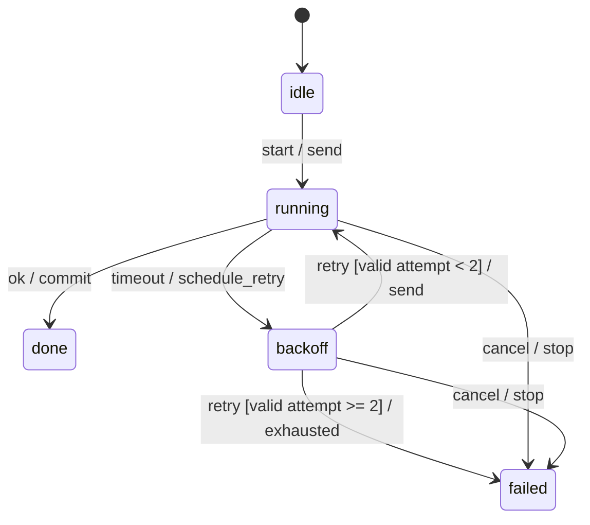
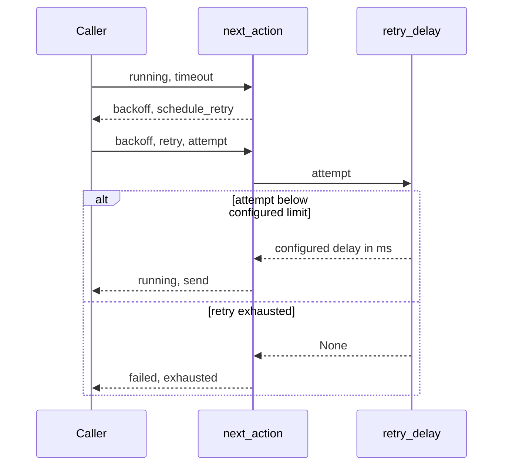

# Synthetic engineering constraints

This is a source-backed teaching fixture, not a deployed system, real protocol or
hardware specification. Source IDs and current positions are supplied by the routes.

## Recovery decision model

`recovery.py::next_action` selects an action without performing it. It never sends
a request, sleeps, owns a timer, schedules a thread or proves an elapsed deadline.
The caller supplies the retry attempt; `retry_delay` returns milliseconds or None
when that supplied attempt reaches 2. This is a conditional bound: the caller must
advance the counter correctly; repeatedly passing 0 keeps permitting send. There
is no cumulative counter, real scheduler or request/generation correlation here.
The base delay 25 ms is a configured
fixture constant, not a measured or recommended production latency.

The route declares five states × five events = 25 pairs: 6 accepted pairs (7 guarded
transitions because retry splits at exhaustion) and 19 ignored pairs. Unknown input
states/events raise ValueError. Multiple guard branches are reviewed against source;
enumeration does not prove concurrency, races or all possible real inputs. Guards
below assume an exact nonnegative integer attempt. Only backoff/retry validates
attempt; terminal states ignore that parameter, including invalid values.

| Scenario | Current result | Boundary |
|---|---|---|
| running + ok | done / commit | No response/generation ID is checked |
| backoff + ok | backoff / ignored | A late reply during backoff is ignored |
| after retry resumes running + old ok | done / commit | Old and current responses cannot be distinguished |
| done/failed + declared event | same state / ignored | Does not repeat terminal actions |
| backoff + retry, attempt repeatedly 0 | running / send each time | Caller bookkeeping is required for a cumulative bound |

### Declared recovery states

This projection omits the 19 ignored pairs; the machine-readable table records
them. done/failed ignore declared events including late replies and retries.

### Timeout and retry decision sequence

The caller, handler and policy are call boundaries, not network services. Retry-limit
checking precedes permission to send. The diagram omits ignored events and invalid
input exceptions, documented in the model and source. Actual timing is not measured.

## Heartbeat wire contract

Authority is `heartbeat.py::FRAME`, a Python network-order serializer, not a manual
C structure or compiler ABI. encode_heartbeat produces exactly 8 bytes:

| Field | Offset bytes | Size bytes | Type / unit | Constraint |
|---|---:|---:|---|---|
| version | 0 | 1 | u8 / dimensionless | 1 |
| flags | 1 | 1 | u8 / bitmask | Only 0x03 bits allowed |
| length | 2 | 2 | u16 / bytes | 8 |
| sequence | 4 | 4 | u32 / count | 0 through 0xffffffff; current Python encoder also accepts bool as 0/1 |

All fields are non-nullable. Byte order is big/network; this says nothing about
native C alignment. A fixed independent byte vector and malformed-header cases in
test_engineering_contracts.py exercise the actual serializer and decoder. No network
peer, physical device or performance budget is verified. Type errors may propagate;
decoder ValueError covers known size/header/mask failures, not arbitrary inputs.

## Fixture decisions and rationale

The recovery design accepts a fixed attempt limit, conditional on the caller
advancing its supplied counter. It does not independently prevent unbounded calls
with attempt 0. Alternatives were unlimited retries or a caller-only check.
The helper is pure so offline boundary tests need no clocks or IO. 25 ms is
only a deterministic fixture value; revisit it before any real workload is attached.

The wire example chooses an explicit network-order Struct to avoid a duplicated
handwritten/native memory layout. Alternatives were native-aligned packing or JSON.
The cost is a fixed versioned frame and a migration need for new fields; revisit
before adding fields or claiming compatibility with an external device. Both are
accepted choices for this fixture, not evidence of optimal production design.

The recovery/byte-vector test cases selected for this feature exercise specific
boundaries, not every declared pair/parameter branch. Pair documentation coverage
and actually executed test coverage are distinct. Wire u32 describes encoded bits,
not exact Python type validation: bool is accepted and unrelated type/serializer
exceptions can propagate. Strict input typing would be a proposed behavior change.
