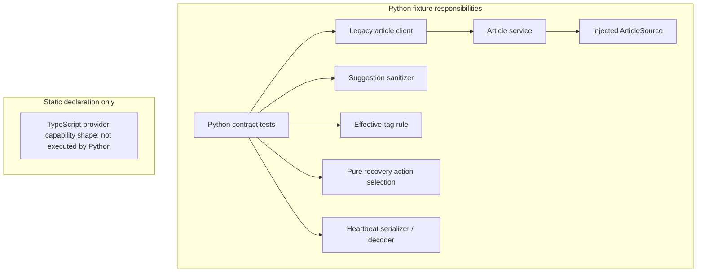
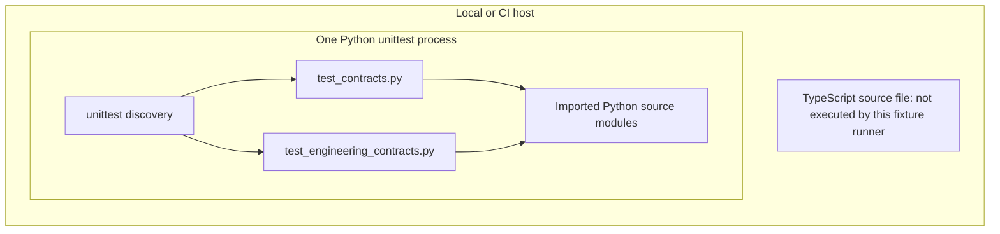
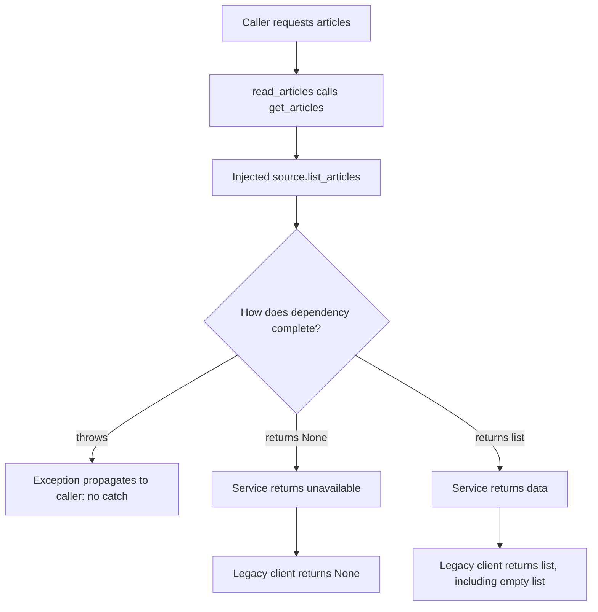
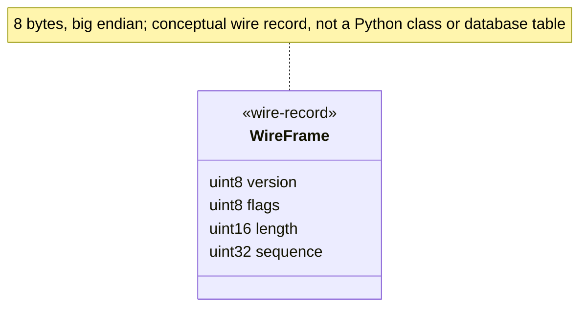

# Project-level views of the synthetic offline fixture

The diagrams below describe existing fixture responsibilities and its offline test
process. They do not describe a server, deployed provider, device or production
topology. Public source IDs and current symbols are located by `project-views`.

## Architecture: responsibilities and dependency directions

**Diagram sources:** `project-views` source IDs `service`, `port`, `client`,
`tagger`, `tags`, `recovery`, `wire`, `contracts`, `engineering-tests`,
`typescript`. These locate the responsibilities, consumers and static declaration.

These are independent fixture examples, not one implemented end-to-end pipeline.
The TypeScript shape is not executed by the Python checks. ArticleSource is an
injected dependency, not an existing hosted API. Arrows show current call/dependency
direction; they do not indicate sockets or separate processes.

## Deployment: the environment that actually runs the fixture tests

**Diagram sources:** `project-views` source IDs `contracts` and
`engineering-tests` locate the unittest consumers and their imports. The displayed
unittest process is the documented invocation, not a source-proven host topology.

No database, network service, container or transport peer is started. This diagram
describes the process used by offline unittest invocation; it does not assert any
platform matrix from fixture source. CI configuration/run evidence belongs outside
this fixture's source claims. This is an offline execution/deployment view of a library fixture, not
proof of installed production operation. A real deployment would need a new design
and separate acceptance evidence.

## Flow: article read, returned failures and thrown errors

**Diagram sources:** `project-views` source IDs `client`, `service`, `port`
locate the call chain and distinguish returned None from propagated exceptions.

This flow separates returned unavailable from successful empty data and uncaught
exceptions. No HTTP handler or new result-style client exists in the fixture.

## Data model: the serialized value record

**Diagram sources:** `wire-format` source ID `frame` locates `src/heartbeat.py`
`FRAME`; source IDs `encode` and `decode` locate the serialized field use.

There are no entity relations or persistence claims to invent. The authoritative
Struct, byte offsets, units, masks and independent vector are in the
[wire contract](engineering-contracts.md#wire-format). This view explains data
structure; the field table explains physical serialization. Neither is a native ABI.

## Cross-view links

- [State diagram](engineering-contracts.md#recovery-state): accepted transitions;
  ignored pairs and context constraints remain in the route/table.
- [Sequence diagram](engineering-contracts.md#recovery-sequence): timeout and retry
  call order; no actual send or timer is performed.
- [Interface map](interfaces.md): article, provider, model and effective-tag contracts.

Six view kinds are declared across the project routes. Each answers its own question;
the helper checks their references/type coverage, not diagram syntax or semantic truth.

**Section sources:** Responsibility and call-direction prose uses the
`project-views` route locators; serialization prose uses `wire-format`. Resolve
current positions with the helper or the [generated route index](route-index.md).
These blocks identify source scope; semantic support is reviewed separately.
