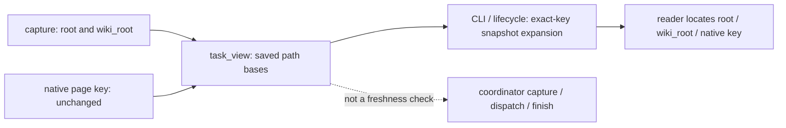

# Native wiki collaboration workflow

This optional CLI bridges an existing JSON task router. It does not replace the
project's wiki, debt ledger, source policy or Git workflow. The initial supported
report shape has `query`, `cards`, `impact`, `omitted`, `placementIssues`, `limits`.
Cards and every file's satellite list are preserved, not reduced to top results.
An optional `workflow` object belongs to the native router: it can expose its own
finish command, commit acknowledgement format, authority paths and limitations.
Every reading view and delegated packet retains it as `native_workflow`; an older
router without it is explicitly undeclared. This is quoted project context, not
an execution request. The plugin neither invents a generic commit footer nor runs
the native gate. A valid `finish` reconciliation cannot replace the project's
actual commit/push checks. Include the defining helper in declared runtime inputs
so changes to those rules make captured context stale.
Projects without this shape keep using the standalone route helper or their own
native workflow; a missing adapter is not a defective wiki.

## Optional lifecycle delivery

The package builder's `--with-lifecycle-hooks` profile includes separate Codex and
Linux Claude `SessionStart` definitions. The default package remains skill-only.
Both profiles use the same canonical skill and Python workflow. No installation,
trust file, host settings, model credentials or running session is changed by
building a package. Hook definitions are intended for internal/manual distribution.

For the observed Codex0.160 host, the hook profile defaults to a **legacy host
container**: generated `.codex-plugin/` and `.claude-plugin/` manifests, with no
portable root `plugin.json` in the output. Canonical identity still has exactly
one source (`plugin.json` in the source checkout), retained and source-bound in
the receipt. This is not a second identity registry or another Wiki. The matching
upstream runtime tag explicitly skips hook loading for portable AgentPlugin
format, even when its OpenAI extension declares the hook path. Explicit
`--hook-layout portable` remains available for other host capabilities; it is not
observed working for hooks on0.160. Plain packages retain their portable root.
Doctor names the selected container projection, validates both generated host
manifests and rejects a mixed legacy/portable output. Compatibility projections
and actual host discovery/trust/execution are still separate evidence layers.

The coordinator sets `PROJECT_WIKI_PACKET` to the absolute existing work-packet
JSON for a new scoped host process. Startup, resume, clear, compact and fork can
deliver its **saved index**, using `task_view(..., snapshot_only=True)` in the
original workflow. The host cwd must belong to the packet's local checkout;
another checkout is refused. This does not authenticate a packet or prove its
source identities current. A coordinator must still use normal capture/dispatch
checks before assigning new work, and the original final reconciliation afterwards.

No selection is a quiet opt-out. The adapter never invokes Git/native routing,
commands quoted in the packet, models or tools; it does not read a transcript,
write an import cache, scan Wiki files or log raw hook input. Invalid selection
or malformed input emits a delivery warning without blocking unrelated work.
An index above the 6 KiB ASCII context budget is explicitly **not delivered**, with a
pointer to the explicit `PROJECT_WIKI_PACKET` selection and standalone snapshot reader; it is not silently
truncated into a purported complete impact inventory. The short wrapper is added
after that check. Overflow never expands the selected path (Unicode paths cannot
inflate the fallback). Codex's separate 8,000-token preview policy remains host-owned,
and direct command replay is not proof of what a trusted host delivers. Task content is labelled
untrusted data. Hook delivery is neither physical reading nor semantic adoption.

Codex uses `python3` on Unix and a `commandWindows` override using `python`;
Linux Claude uses `python3`. Python 3.10+ must already be available in that host's
PATH. The installed plugin root is resolved inside Python from the host-provided
`CLAUDE_PLUGIN_ROOT`, without shell-expanding project paths. The host-specific
definitions add no permission policy or automatic completion gate.

Before exercising a host, review its current support and trust configuration.
Codex requires review/trust of the exact non-managed definition: `/hooks` in the
CLI, or Hooks settings in a desktop build that supports that entry. Check the
selected local host; a separate CLI process and the desktop's embedded backend
can have different versions and definition hashes. Do not assume one attests the
other. Review the actually listed definition;
never write trust records or use a bypass to manufacture acceptance. Claude's
normal project/plugin trust and enabled-hook policy also apply. Local execution,
actual host triggering, delivered context, reader use and business correctness
require separate evidence. An active scoped worker is not upgraded in place.
Unsupported or untrusted hosts keep the existing explicit CLI task-package path.

References: [Codex hook inputs, trust and local execution](https://learn.chatgpt.com/docs/hooks),
[manual plugin hook packaging](https://developers.openai.com/plugins/build/plugins),
[Claude hook reference](https://code.claude.com/docs/en/hooks).

## Context capture

```text
python <skill>/scripts/workflow.py capture --root <checkout> --query "feature symptom" --files <planned-file...> --native-argv '["local-runtime","reviewed-native-router"]' --runtime-input <router-source> --allow-native-execution --output <new-private-capture.json>
```

The caller chooses a reviewed local argv, not a shell command extracted from wiki
text. The explicit execution flag is a tool invocation choice, not a new human
approval ceremony when the work is already authorized. Capture appends the task,
`--json` and `--files`; native tools may write their own local task stamps. It never
runs commands quoted in task cards. Prefer an already-installed local runtime,
not a runner which downloads dependencies. Declare runtime inputs, including the
native parser/model modules; their closure is caller-supplied, not automatically
inferred from imports.

The snapshot binds Git HEAD, declared runtime inputs, native wiki Markdown and
planned source bytes. Hashing wiki inputs occurs only on explicit capture or
freshness checks; it is not a full-wiki prompt or an every-turn hook. Native output
over 4 MiB fails rather than being silently clipped. Native stderr contents are
not copied into the packet. The native command timeout is 60 seconds, not a
sandbox or a process-tree/resource isolation guarantee.

Use `--peer alias=/checkout` for a coupled repository and prefix its paths with
that alias. A missing peer remains unavailable, not an empty successful diff.
Each selected peer is bound to its actual checkout/HEAD. The tool cannot certify
that the selected pair is the correct deployment pair; verify that separately.

When the native router reports its selected checkout identities, opt into comparing
those observations with the selected root and every declared peer:

```text
... capture ... --native-source-context /workflow/context/sources
```

This caller-selected JSON pointer addresses an object whose arbitrary labels each
contain `root` (checkout path) and `revision` (full Git HEAD). The pointer is adapter
configuration, not a command copied from a page. Object keys, escaped `~0`/`~1`
tokens and array indices are supported; malformed escapes or array indices reject.
No project or repository label is built into the helper. Every selected checkout
must have a matching identity; unrelated optional source records do not participate
in this comparison. Missing/unknown selected identities, a different checkout, an
old revision or contradictory selected observations reject the capture. Without this option,
the comparison remains explicitly `not_requested`; legacy adapters still work.
The matched comparison follows every reading view and delegation, and the final
capture must retain the same comparison policy. A strict capture missing its saved
comparison is rejected for new dispatch and displayed as unavailable, while old
captures without either field stay `not_requested`. The final reconciliation carries
the checked policy and comparison. It compares reported identities;
it does not prove physical reads, a correct deployment pair or semantic adoption.
Do not silently choose another checkout or rewrite the native report to make it pass.

## Start, display and delegate

### Selected evidence files

When a task must retain earlier raw results outside the selected checkouts, repeat
`capture --preserve-artifact <absolute-existing-file>`. Select the original result
and any other specific evidence that must survive. This is optional; legacy
captures explicitly remain `not_requested`. It does not scan private directories
or copy file contents into a packet. Relative paths, missing files, directories
and symlink aliases are refused.

Selected paths and SHA256 observations follow start, every reading view and
delegation. Capture checks before/after the native router; dispatch checks current
bytes. The final capture must repeat the same selection. Both review preparation
and finish reject dropped, expanded or changed selections and changed bytes,
even when Git reports no repository changes. A successful final observation is
named `unchanged_at_finish`, separately from capability review and runtime status.

Before reusing a probe, inspect **all of its output destinations**, including
paths derived from its own directory. Route a new run to a distinct output file;
do not merely change the source checkout and retain a historical output path.
The CLI's own projections remain write-new-only. If a result is accidentally
overwritten, preserve the accidental run and any recovery record separately;
only a verified saved preimage can restore original bytes. A replay is a new run.

This guard observes selected bytes at checkpoints. It neither prevents writes nor
continuously watches files, certifies their original provenance, enforces a
filesystem sandbox, proves a physical read or verifies semantics/business flows.
A change restored between observations is not detected; an exact saved preimage
restoration may honestly match. Unselected evidence is outside this policy.
Packets are unsigned local projections; editing both a task's policy and its
saved hashes is not an authenticated history.

```text
python <skill>/scripts/workflow.py start --capture <capture.json> --task-id <id> --owner <owner> --outcome "observable result" --allow-file <file> --capability "required user capability" --acceptance "exit evidence" --output <new-task.json>
python <skill>/scripts/workflow.py show --packet <task.json>
python <skill>/scripts/workflow.py show --packet <task.json> --view feature --path <feature-path>
python <skill>/scripts/workflow.py show --packet <task.json> --view impact --path <impacted-file>
python <skill>/scripts/workflow.py delegate --packet <task.json> --task-id <child-id> --owner <worker> --allow-file <subset-file> --output <new-child.json>
```

Repeat `--allow-file`, `--capability` and `--acceptance` as needed. Default display
is an index with every selected feature/file, satellite counts, omitted candidates,
required capabilities and exact expansion commands. Read the selected feature and
each relevant file's full impact record; opening the index alone is not receiving
all context. `--view all` retains the complete native records without the bulk hash
inventory, but hosts may persist or clip large output. Exact expansion avoids
relying on a host's preview. No stored native relationship is dropped or summarized
away. Large individual records still require the host's full-output reading path.
A stale display is explicitly historical; fresh dispatch requires recapture.
Delegation cannot widen edit scope, and does not send messages or start an agent.
Pass the resulting private packet through the project's authorized coordinator.

Every saved reading view also exposes the capture's `wiki_root` and explicit path
bases. Native feature and satellite page keys are relative to `root / wiki_root`;
source files are relative to the checkout, or to a declared peer selected by its
alias prefix. Keep the native key itself in `show --path` (for example,
`feature.md`); prepend the saved Wiki base only when locating its actual file.
This avoids reading a stale same-named file at the checkout root. No default Wiki
directory is invented when older or incomplete context omits `wiki_root`.
Snapshot-only mode preserves foreign path strings without probing or resolving
them on the reader's host; these bases do not certify existence or freshness.



### Reading when the worker cannot invoke Git

The default `show` performs a live freshness check. It can invoke read-only Git
and hash declared inputs, even when the packet has `access: read_only`.
That access field does not grant host command permissions. A worker forbidden to
invoke Git must not run the default display just because its task is a review.

After the authorized coordinator checks the current packet and sources, a
constrained reader may use the explicit saved-record mode:

```text
python <skill>/scripts/workflow.py show --packet <task.json> --snapshot-only
python <skill>/scripts/workflow.py show --packet <task.json> --snapshot-only --view feature --path <feature-path>
python <skill>/scripts/workflow.py show --packet <task.json> --snapshot-only --view impact --path <impacted-file>
```

This display does not call Git, a native router or live source/evidence hashing.
Every expansion command keeps the flag. It retains the saved native records,
omissions, peer identities, workflow and selected-evidence records; foreign-host
artifact paths remain saved strings, not validated local paths. `freshness` says
current inputs were **not checked**, and `view_observation` distinguishes this
from a successful live check. Saved identity matches and artifact hashes describe
their capture-time observations; they are not checked again by this display.
An adjacent `native_source_comparison_observation` explicitly qualifies the saved
comparison as capture-time data, even when its retained status says `matched`.
The original comparison record is preserved without relabelling its contents.

The coordinator's check and the worker's actual reading are separate evidence.
Neither is a trace of every physical read or proof of semantic/business adoption.
Packets remain unsigned local projections. This flag establishes no permission,
trust, currentness or completion, and is unavailable on `capture`, `start`,
`delegate`, `review-template` and `finish`. Those operations retain their original
live-input checks and selected-source/evidence guards. A saved display cannot be
used to accept changed inputs or dispatch a stale task. If no safe reader command
is available, the coordinator can deliver the actual saved projection directly
with the same limitations; do not relax the worker's command prohibition.

For a review with no authorized repository edits, use `start --read-only` without
`--allow-file`. The capture's planned files remain readable context; the packet's
`allowed_files` is empty and every display includes `access: read_only`. Do not
invent a dummy edit permission just to send an audit task. An editing parent may
delegate a narrower `--read-only` child with no edit paths; a read-only parent can
only delegate read-only children and cannot regain editing paths. Older packets
without `access` retain their existing editing semantics.

Access describes task scope, not a filesystem sandbox or a host permission grant.
Use the host's real read-only tools/mode where available and independently inspect
the return. A read-only reconciliation rejects observed repository differences,
including wiki changes which an editing task may justify. It compares against the
captured Git base, so an already dirty/recovered tree is conservatively rejected
as an unchanged return; use a clean isolated base when that proof is required.
It does not observe transient reverted writes, ignored files or external state.

Capabilities come from the intended user result, not just existing implementation.
For example, a compact editor and a full editor may share storage but expose
different title/tag/media controls. Draft preservation across back/close/re-entry
is another capability. The actual product's fields and role/environment/client
variants belong to its native feature page and task, not to generic hardcoded rules.

## Reconcile the actual return

Once the worker has stopped, collect the real diff from the packet's base across
all selected checkouts. Query the native router again with **all actual files**,
including new tests/docs/consumers, and capture that result. Do not reuse a planned
file list or old ranking output as the final scope.

```text
python <skill>/scripts/workflow.py finish --packet <task.json> --after-capture <actual-capture.json> --review <review.json> --output <new-reconciliation.json>
```

For a new worker, `review-template --packet <task.json> --after-capture
<actual-capture.json> --output <new-review.json>` prepares the exact capability
keys, actual file satellites and unregistered paths. Fill the generated review
before passing it to `finish`: every status starts `unreviewed`, reasons are
empty, and no decisions or capability evidence are inferred. An untouched
template fails reconciliation. It is optional formatting help, not another gate.
`pages`, `capabilities` and `unregistered` are keyed objects, not lists. Verified
`references` are reachable repository-relative file paths (with a declared peer
alias when needed); put line ranges, symbols and prose in `reason`. Keep richer
human findings separately rather than substituting them for these fields.

Review shape (the paths and capabilities are project-specific):

```json
{
  "pages": {
    "feature.md": {"status": "updated"},
    "consumer.md": {"status": "no_update", "reason": "The inspected consumer contract is unchanged."}
  },
  "capabilities": {
    "required user capability": {
      "status": "source_verified",
      "reason": "Source wiring inspected; runtime still pending.",
      "references": ["src/editor.py"]
    }
  },
  "unregistered": {
    "tests/new-case.py": "Test file; behavior source is registered on feature.md."
  },
  "handoff": {
    "remaining": ["actual cross-client interaction"],
    "next_safe_action": "Run the staged flow at the exact candidate revision."
  }
}
```

For an unchanged read-only return, the actual diff and final native `--files`
list are empty. Use a normal native query for that final capture when an optional
source-analysis flag requires explicit files; do not fabricate changed files to
keep the flag enabled. Inspectable capability evidence and the handoff remain
required. Native per-file extension data (such as deterministic source-structure
facts) stays in exact impact views without becoming a semantic coverage claim.

Unregistered functional files need routing repair; a reason does not establish
semantic completeness. A page marked updated must have a real diff. No-update
needs a reason. Every required capability needs a status and explanation; verified
claims also need reachable references. `gap` and `not_applicable` are explicit
statuses, not invisible omissions. The report preserves reviewer claims without
independently certifying them or treating a log's existence as a passed test.

Reconciliation reports exact HEADs, actual files and content hashes, distinguishes
working-tree changes from the task's base, preserves omitted candidates and gaps,
and requires remaining work/next action. It performs no source edits or project
checks. Structural closure never means the product, deployment or goal is complete.
Unsigned local packets are provenance aids, not adversary-resistant signatures.

## Adoption evaluation

Exercise omitted satellites/capabilities, stale or moving inputs, wrong peer pairs,
missing peers, extra consumers, new untracked recovery files and wrong evidence
paths. Then use real tasks and inspect whether the successor actually used the
packet. Compare effort and omissions only with measured cases. A guided retry by
the same worker is recovery evidence, not an independent blind efficiency trial.

## Host observations

When a plugin package is present, its existing `scripts/plugin_doctor.py` is at
the **plugin root**, outside `skills/project-wiki`. Standalone skill/CLI users do
not need a plugin installation or a new host configuration to use the workflow.

```text
python <plugin>/scripts/plugin_doctor.py --package <selected-package> --source <canonical-source>
python <plugin>/scripts/plugin_doctor.py --package <selected-package> --codex-inventory <saved-official-inventory.json> --codex-marketplace <explicit-marketplace> --codex-version-file <saved-version-stdout.txt>
```

The caller can save official `codex plugin list --marketplace <marketplace>
--json` and `codex --version` stdout with the host's normal tool. Doctor only reads
these files and never invokes the CLI, follows a source path, installs anything
or changes hook trust. `--claude-transcript` remains a separate scoped-event
inspection. Do not substitute a model-written claim for a host record.

Package integrity must pass before matching a Codex record. Identity is explicit
name+marketplace; stale version, disabled state and absence are retained, not
upgraded into a pass. The snapshot and optional host version are unsigned supplied
evidence. No freshness, complete host inventory or cache-byte binding follows.
Top-level evidence layers remain unverified; the nested observation says exactly
what the provided record reported. Exit0 certifies neither installed-current
state nor hook execution, context delivery, actual use, semantics or business
acceptance. Combine this bounded observation with actual host/tool/read/runtime
evidence when reporting the six layers; do not collapse them into one green badge.
